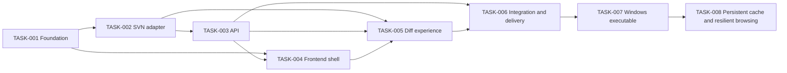

# SVNLab Implementation Plan

## Goal

Deliver the approved local, read-only SVN repository browser with a FastAPI backend, native HTML/CSS/JavaScript frontend, complete per-revision diff page, split/unified views, and on-demand source context.

## Sources and Repository Baseline

- Approved design: `docs/superpowers/specs/2026-10-12-svnlab-design.md`
- Repository baseline: design-only Git repository at commit `8586572`; no production or test code exists.
- Environment evidence: Python 3.14.6 and Node.js 24.16.0 are available; the `svn` executable is not currently installed.
- Repository instruction: all shell commands are prefixed with `rtk`.

## Constraints and Assumptions

- The runtime depends on an installed official SVN CLI; installing it globally is outside repository scope.
- Application login and all repository write operations are out of scope.
- Repository credentials remain in browser `localStorage` and request bodies only.
- The server binds to loopback by default.
- The frontend has no build step or framework.
- Tests that require the real SVN executable skip with an explicit reason when it is unavailable; subprocess contract tests still run.
- The user authorized recommended intermediate choices and requested only final-result review.

## Dependency Overview

## Tasks

### TASK-001 Establish application foundation and contracts

Status: approved
Depends on: none

#### Goal

Create the Python package, dependency metadata, shared request/response models, configuration, and test harness that later layers use.

#### Scope

- Expected files or modules: `pyproject.toml`, `svnlab/__init__.py`, `svnlab/config.py`, `svnlab/models.py`, `tests/conftest.py`.
- Define validated connection, pagination, revision, diff, and content-range models.
- Define process limits and cache limits as application settings.

#### Out of Scope

- Running SVN commands.
- HTTP routes.
- Frontend behavior.

#### Acceptance Criteria

- [ ] The package imports under the supported Python version.
- [ ] Invalid revisions, page sizes, repository values, and content ranges are rejected.
- [ ] Dependencies and test commands are documented in project metadata.

#### Verification

- `python -m pytest tests/test_models.py`

#### Risks and Review Focus

- Keep models transport-focused so they do not leak subprocess details into the frontend contract.

### TASK-002 Implement the safe SVN adapter and parsers

Status: approved
Depends on: TASK-001

#### Goal

Provide a bounded, testable service for SVN info, logs, revision diffs, and file content.

#### Scope

- Expected files or modules: `svnlab/svn_client.py`, `svnlab/parsers.py`, `svnlab/errors.py`, focused unit tests.
- Build argument arrays with non-interactive and no-auth-cache flags.
- Run subprocesses without a shell, with concurrency and timeout bounds.
- Parse info/log XML and SVN unified diff/property/binary sections.
- Map process failures to redacted domain errors.

#### Out of Scope

- FastAPI response handling.
- HTML rendering.
- Persistent caches.

#### Acceptance Criteria

- [ ] Credentials never appear in raised errors or logs.
- [ ] Representative multi-file, property, binary, added, and deleted diffs parse without dropping sections.
- [ ] Timeout and missing-executable paths produce distinct domain errors.
- [ ] Repository paths containing `@` are handled safely.

#### Verification

- `python -m pytest tests/test_svn_client.py tests/test_parsers.py`

#### Risks and Review Focus

- SVN diff formats vary by client version; retain raw fallback content for unrecognized sections.

### TASK-003 Expose repository APIs and bounded content cache

Status: approved
Depends on: TASK-002

#### Goal

Expose the approved same-origin JSON API and serve the frontend safely.

#### Scope

- Expected files or modules: `svnlab/app.py`, `svnlab/api.py`, `svnlab/cache.py`, API tests.
- Implement health, connection check, commit list, commit detail, and file-content endpoints.
- Map domain failures to stable HTTP error envelopes.
- Add bounded TTL source cache and per-line range responses.
- Mount packaged static assets with SPA fallback behavior.

#### Out of Scope

- Browser layout and diff rendering.
- Cross-origin deployment.

#### Acceptance Criteria

- [ ] All credential-carrying operations use POST bodies.
- [ ] Static files and health endpoint work without repository settings.
- [ ] Single-file content failure does not affect other requests.
- [ ] Errors are actionable and contain no passwords.

#### Verification

- `python -m pytest tests/test_api.py tests/test_cache.py`

#### Risks and Review Focus

- Avoid route ordering that lets the SPA fallback mask `/api` errors.

### TASK-004 Build the GitLab-inspired application shell and commit pages

Status: approved
Depends on: TASK-001, TASK-003

#### Goal

Provide the polished responsive shell, repository setup, commit list, routing, and loading/error states.

#### Scope

- Expected files or modules: `svnlab/static/index.html`, `svnlab/static/styles.css`, `svnlab/static/app.js`.
- Implement localStorage settings, connection test, hash routing, sidebar, top bar, commit list, and cursor pagination.
- Use semantic markup, keyboard-accessible controls, visible focus, and responsive layout.

#### Out of Scope

- Diff parsing or rendering.
- Repository write actions.

#### Acceptance Criteria

- [ ] First run opens setup and successful setup opens commits.
- [ ] Returning users load saved settings without exposing them in the URL.
- [ ] Commit rows show all approved metadata and navigate by hash route.
- [ ] Layout remains usable on narrow screens.

#### Verification

- API-backed smoke test plus static syntax/DOM inspection.

#### Risks and Review Focus

- Keep app state and DOM updates understandable without introducing a framework.

### TASK-005 Implement complete revision diff and source exploration

Status: approved
Depends on: TASK-002, TASK-003, TASK-004

#### Goal

Render every changed file and complete diff automatically on one revision page, with split/unified views and context/source exploration.

#### Scope

- Expected files or modules: focused additions to `app.js` and `styles.css`, frontend fixtures/tests where practical.
- Render revision metadata and sticky file index.
- Render all file diffs without per-file load actions.
- Implement global split/unified switching and automatic narrow-screen unified mode.
- Implement file-content mode and upward/downward/bidirectional context expansion in 20-line increments.
- Render added, deleted, binary, copied, and property-only states.

#### Out of Scope

- Syntax highlighting libraries.
- Inline commenting or code review submission.

#### Acceptance Criteria

- [ ] Opening a revision automatically displays every diff file and hunk.
- [ ] File index anchors scroll to already-rendered sections.
- [ ] Split and unified modes preserve readable old/new line numbers.
- [ ] Context controls load and insert the requested range and disappear at boundaries.
- [ ] Repository-controlled text is inserted only through text-safe DOM operations.

#### Verification

- Parser fixtures, browser smoke checks, and manual desktop/narrow viewport inspection.

#### Risks and Review Focus

- Split-row alignment and context expansion can become inconsistent around mixed additions/deletions; keep transformation functions pure and fixture-tested.

### TASK-006 Complete integration verification and delivery documentation

Status: approved
Depends on: TASK-003, TASK-005

#### Goal

Validate the assembled application and make it straightforward to install and run.

#### Scope

- Expected files or modules: `tests/test_integration_svn.py`, `README.md`, final packaging adjustments.
- Add temporary-local-repository integration coverage that skips when SVN tools are missing.
- Run the full test suite and local HTTP smoke test.
- Document Windows/Linux Python and SVN prerequisites, installation, startup, privacy limitations, and usage.
- Visually inspect the delivered UI at desktop and narrow widths.

#### Out of Scope

- Installing SVN globally on the user's machine.
- Production reverse proxy, TLS termination, or public hosting.

#### Acceptance Criteria

- [ ] Full test suite passes, with any environment-dependent skip clearly identified.
- [ ] The app starts with the documented command and health/static routes respond.
- [ ] README accurately describes credential storage and command-line exposure limitations.
- [ ] Git working tree contains only intentional project changes.

#### Verification

- `python -m pytest`
- Start the documented server and request `/api/health` and `/`.

#### Risks and Review Focus

- The current environment lacks SVN CLI, so real integration proof may be a documented skip unless a project-local executable becomes available.

### TASK-007 Package and verify the Windows executable

Status: approved
Depends on: TASK-006

#### Goal

Produce a self-contained single-file Windows executable that embeds SVNLab's Python runtime and frontend assets while continuing to use the installed SVN CLI.

#### Scope

- Expected files or modules: `svnlab/__main__.py`, `pyproject.toml`, `svnlab.spec`, `scripts/build-exe.ps1`, `README.md`.
- Add configurable host and port command-line options with loopback-safe defaults.
- Define reproducible PyInstaller packaging for the application and static resources.
- Build `dist/SVNLab.exe` and verify its health and static routes on a non-default port.

#### Out of Scope

- Bundling or redistributing SVN CLI binaries and DLLs.
- Code signing, an installer, Windows service registration, or automatic firewall changes.

#### Acceptance Criteria

- [ ] `dist/SVNLab.exe` starts without a Python installation.
- [ ] The packaged server accepts `--host` and `--port` while defaulting to `127.0.0.1:8000`.
- [ ] `/api/health`, `/`, and `/assets/app.js` respond from the packaged process.
- [ ] Build and intranet startup instructions document the SVN CLI and no-authentication security boundary.

#### Verification

- `uv run pytest`
- `powershell -ExecutionPolicy Bypass -File scripts/build-exe.ps1`
- Start `dist/SVNLab.exe --port 8765` and request the three acceptance routes.

#### Risks and Review Focus

- PyInstaller must include package data that Python imports do not discover automatically.
- LAN binding exposes an unauthenticated service; it remains explicit opt-in and must be documented.

### TASK-008 Add persistent caching and resilient commit browsing

Status: ready
Depends on: TASK-007

#### Goal

Avoid repeated SVN traffic for previously loaded data, show the first four SVN log lines in commit rows, and tolerate slow remote repositories with longer bounded timeouts.

#### Scope

- Expected files or modules: `svnlab/cache.py`, `svnlab/config.py`, `svnlab/models.py`, `svnlab/api.py`, `svnlab/app.py`, `svnlab/static/app.js`, `svnlab/static/styles.css`, focused tests, `README.md`, and regenerated `dist/SVNLab.exe`.
- Persist commit pages, revision details, and full file contents in a local SQLite database keyed by repository and username scope without storing passwords.
- Add an explicit latest-page remote refresh that overwrites only after a successful response.
- Render up to four original SVN log lines in the commit list.
- Increase bounded SVN command timeouts to the approved operation-specific values.
- Rebuild and smoke-test the Windows executable.

#### Out of Scope

- Mirroring or checking out the SVN repository.
- Background polling, automatic cache expiry, distributed cache synchronization, or caching authentication failures.
- Storing SVN passwords in the cache.

#### Acceptance Criteria

- [ ] Repeated commit-page, revision-detail, and file-content requests survive process restart without another SVN data call.
- [ ] Cache entries are isolated by repository and username, and contain no password.
- [ ] Explicit latest-page refresh replaces cached data only after successful remote retrieval.
- [ ] Commit rows render the first four log lines and preserve their line breaks.
- [ ] Default info/log/content/diff timeouts are 60/180/300/600 seconds.
- [ ] All tests and packaged-EXE health/static smoke checks pass.

#### Verification

- `uv run ruff check svnlab tests`
- `uv run pytest`
- `uv run python tests/visual_qa.py`
- `powershell -ExecutionPolicy Bypass -File scripts/build-exe.ps1`
- Start `dist/SVNLab.exe --port 8765` and request `/api/health`, `/`, and `/assets/app.js`.

#### Risks and Review Focus

- Cached repository content is sensitive local data even without credentials; keep it in the current user's local application-data directory.
- Latest-page refresh must not delete the usable cached response before the remote request succeeds.
- SQLite access must not block unrelated async request handling during filesystem I/O.

## Revision History

- 2026-10-12: Initial plan derived from the approved design and empty repository baseline.
- 2026-10-12: All tasks implemented and internally verified under the user's final-result-only review authorization.
- 2026-10-12: Re-verified after SVN 1.14.2 installation. The real temporary-repository integration test and all 17 automated tests pass.
- 2026-10-12: Added pre-approved TASK-007 for single-file Windows packaging based on `docs/superpowers/specs/2026-10-12-windows-exe-packaging-design.md`.
- 2026-10-12: TASK-007 accepted through final delivery and remote push; added pre-approved TASK-008 from the persistent-cache design.

